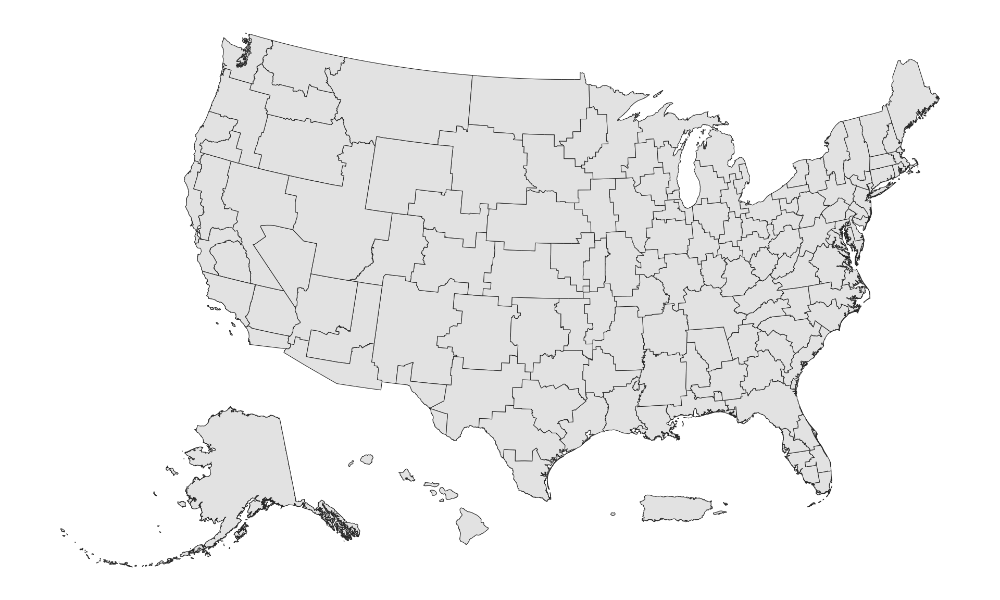

# Veterans Affairs Seasonal Respiratory Surveillance (V5)
{: .no_toc}

| Attribute | Details |
| :--- | :--- |
| **Source Name** | `va_respiratory_cases`, `va_respiratory_vaccinations` |
| **Data Source** | [VA Seasonal Disease Review](https://www.accesstocare.va.gov/Healthcare/SeasonalDiseaseReview) |
| **Geographic Levels** | `va_catchment` (cases only), `state`, `msa` (cases only), `hhs`, `census_division`, `census_region`, `nation` |
| **Temporal Granularity** | Daily, by reference date (season-to-date cumulative counts from Oct 1 to Sep 30) |
| **Reporting Cadence** | Daily |
| **Temporal Scope Start** | 2026-05-27 |
| **Temporal Scope End** | Ongoing |
| **Extra Key Columns** | None |
| **License** | [Public Domain U.S. Government](https://www.usa.gov/government-works) |

## Table of contents
{: .no_toc .text-delta}

1. TOC
{:toc}

---

## Overview

The Department of Veterans Affairs (VA) automated biosurveillance system tracks seasonal respiratory disease cases and vaccinations across VA medical facilities nationwide. Data is reported through the VA Access to Care portal for three key respiratory diseases: COVID-19, Influenza, and RSV.

In the Delphi V5 API, this surveillance is published as two independent data sources:

- **`va_respiratory_cases`**: Daily facility-level cumulative case counts and derived 7-day average daily reported case rates.
- **`va_respiratory_vaccinations`**: Daily state-level cumulative doses administered and cumulative vaccination rates.

---

## Indicators (Signals)

### Cases (`va_respiratory_cases`)

Case indicators reflect cumulative counts and population-adjusted daily reported case rates among Veterans Health Administration (VHA) enrollees:

| Indicator Name | Pathogen or Disease | Metric Type | Description |
| :--- | :--- | :--- | :--- |
| `covid_cases_cumulative` | COVID-19 | Cumulative count | Season-to-date confirmed cases at VA facilities. |
| `covid_cases_per_100k_7dav` | COVID-19 | Rate (7-day average) | 7-day trailing average of daily newly reported cases (derived from cumulative snapshot differences) per 100,000 VHA-enrolled veterans. Includes 90% Wilson confidence intervals (`ci_lower`, `ci_upper`). |
| `flu_cases_cumulative` | Influenza | Cumulative count | Season-to-date confirmed cases at VA facilities. |
| `flu_cases_per_100k_7dav` | Influenza | Rate (7-day average) | 7-day trailing average of daily newly reported cases (derived from cumulative snapshot differences) per 100,000 VHA-enrolled veterans. Includes 90% Wilson confidence intervals (`ci_lower`, `ci_upper`). |
| `rsv_cases_cumulative` | RSV | Cumulative count | Season-to-date confirmed cases at VA facilities. |
| `rsv_cases_per_100k_7dav` | RSV | Rate (7-day average) | 7-day trailing average of daily newly reported cases (derived from cumulative snapshot differences) per 100,000 VHA-enrolled veterans. Includes 90% Wilson confidence intervals (`ci_lower`, `ci_upper`). |

### Vaccinations (`va_respiratory_vaccinations`)

Vaccination indicators track season cumulative uptake across all three pathogens, plus lifetime cumulative uptake for RSV:

| Indicator Name | Pathogen or Disease | Metric Type | Description |
| :--- | :--- | :--- | :--- |
| `covid_vaccines_season_cumulative` | COVID-19 | Cumulative count | Season-to-date doses administered to VHA enrollees. |
| `covid_vaccines_season_cumulative_per_100k` | COVID-19 | Cumulative rate | Season-to-date doses per 100,000 VHA enrollees with 90% Wilson confidence intervals (`ci_lower`, `ci_upper`). |
| `flu_vaccines_season_cumulative` | Influenza | Cumulative count | Season-to-date doses administered to VHA enrollees. |
| `flu_vaccines_season_cumulative_per_100k` | Influenza | Cumulative rate | Season-to-date doses per 100,000 VHA enrollees with 90% Wilson confidence intervals (`ci_lower`, `ci_upper`). |
| `rsv_vaccines_season_cumulative` | RSV | Cumulative count | Season-to-date doses administered to VHA enrollees. |
| `rsv_vaccines_season_cumulative_per_100k` | RSV | Cumulative rate | Season-to-date doses per 100,000 VHA enrollees with 90% Wilson confidence intervals (`ci_lower`, `ci_upper`). |
| `rsv_vaccines_lifetime_cumulative` | RSV | Cumulative count | Total cumulative doses administered since tracking began. |
| `rsv_vaccines_lifetime_cumulative_per_100k` | RSV | Cumulative rate | Lifetime cumulative doses per 100,000 VHA enrollees with 90% Wilson confidence intervals (`ci_lower`, `ci_upper`). |

---

## Estimation

### Metric Definition

Counts are normalized by VHA enrollment rather than the general veteran population to compute rates per 100,000 enrolled veterans using official county-level statistics from the [VHA Enrollees by County dataset](https://www.data.va.gov/dataset/FY2015-VHA-Enrollees-by-County/yrqn-8ty6/about_data):

$$
\text{rate\_per\_100k} = \frac{\text{count}}{\text{enrollees}} \times 100{,}000
$$

For cases, daily newly reported cases ($\Delta C_t$) are derived as the difference between successive cumulative snapshots:

$$
\Delta C_t = C_t - C_{t-1}
$$

> [!NOTE]
> **Differences vs. True Epidemiological Incidence:**
> Daily differences ($\Delta C_t$) represent newly reported cases between consecutive portal snapshots rather than true disease incidence (date of illness onset or infection). Differences reflect administrative reporting flow, batching, and system updates rather than the exact timing of clinical onset.

Vaccinations are reported strictly as cumulative metrics (season cumulative or lifetime cumulative) and are not differenced into daily counts.

### Smoothing

To smooth noise from weekend reporting and administrative batching, Delphi applies a 7-day trailing moving average (`_7dav`) to daily newly reported cases ($\Delta C_t$) before calculating the per-100,000 rate.

#### Deflation Guard

Raw cumulative snapshots occasionally experience temporary single-day drops due to upstream reporting or synchronization anomalies before rebounding the following day. Cumulative indicators publish the raw VA snapshots without modification. For derived daily changes and smoothed rates, a deflation guard zeroes single-day dips and folds the difference into the subsequent recovery day ($$C_{t+1} - C_{t-1}$$).

At the season boundary (September 30 to October 1), cumulative totals reset. The pipeline treats the October 1 count directly as that day's initial reported case count rather than differencing against the prior season.

### Uncertainty

Rate signals include uncertainty estimates quantified using the 90% Wilson score interval ($$z = 1.645$$), published directly in the `ci_lower` and `ci_upper` columns:

$$
\text{CI} = \frac{\hat{p} + \frac{z^2}{2n} \pm z \sqrt{\frac{\hat{p}(1-\hat{p})}{n} + \frac{z^2}{4n^2}}}{1 + \frac{z^2}{n}} \times 100{,}000
$$

where $$\hat{p} = \frac{\text{count}}{n}$$ and $$n$$ is the effective enrolled veteran population for the geographic area. Rate values and confidence bounds are rounded to 4 decimal places.

### Temporal Handling

Observations are referenced daily by observation date (`YYYY-MM-DD`), parsed from the scraped file prefix:

- Surveillance seasons run October 1 through September 30.
- `reference_time` represents the observation date.
- `report_time` is the UTC date when Delphi processed the snapshot.
- The upstream portal overwrites files under the same name and retains approximately one month of history. To avoid redundant uploads during intra-day oscillations, the ingestion pipeline stores a new file only if its content differs from the last 4 stored versions for that date.

### Geographic Handling

The Veterans Health Administration (VHA) provides care through regional Healthcare Systems (HCS) and Medical Centers (VAMC). Because patient draw areas follow healthcare delivery patterns rather than political boundaries, facility service areas often span across state lines:

- **Cases (`va_respiratory_cases`):** Reported natively at the VA catchment (`va_catchment`) level across 139 facilities nationwide. Catchment case counts are disaggregated to constituent counties using veteran enrollee population weights from the *VHA Enrollees by County* dataset (FY2015), then re-aggregated up through Delphi's standard geographic crosswalk to `state`, `msa`, `hhs`, `census_division`, `census_region`, and `nation`. Raw county counts are not published directly to prevent low-cell disclosure.
- **Vaccinations (`va_respiratory_vaccinations`):** Reported natively at the state level (`state`). These aggregate upward directly to `hhs`, `census_division`, `census_region`, and `nation` using enrollee population weights. Non-US entries (`ph` for the Philippines and `other`) are excluded during aggregation.

#### Understanding `va_catchment` Geographic Levels

The VHA administrative structure is organized into a nested hierarchy of 18 VISNs (Veterans Integrated Service Networks), 97 Markets, 153 Submarkets, 568 Sectors, and 3,225 Counties. However, **facility catchment areas do not align with this administrative hierarchy or with standard political state borders**. For example, submarkets are often served by multiple medical facilities, and medical centers located near state borders routinely draw patients from surrounding counties in neighboring states.

To establish spatial boundaries for the 139 facilities reported in the case data, Delphi reconstructed the facility catchment geometries:

1. **Continental Facilities (134 polygons):** Raw vector path contours were extracted from the VA National Surveillance dashboard map and georeferenced to WGS-84 coordinates via a Lambert Conformal Conic metric projection. Official county boundaries were then dissolved based on the containing SVG catchment polygon of each county's representative point, producing clean, county-aligned boundaries.
2. **Non-Continental Territories (3 regions):** Facilities in Alaska, Hawaii, and Puerto Rico were formed by unioning all counties, boroughs, or municipios within each respective state or territory.
3. **Co-Located Facilities (2 facilities):** Two facilities share metropolitan areas with partner facilities and lack separate polygons in the source dashboard: `Long Beach, CA HCS` (co-located with `Greater Los Angeles HCS`, assigned Los Angeles and Orange counties) and `New York Harbor HCS` (co-located with `Bronx HCS`, assigned New York/Manhattan and Kings/Brooklyn counties). These share the geometries of their parent metropolitan systems.

*Reconstructed catchment boundaries for all 139 VA healthcare facilities across the United States. Non-contiguous states and territories (Alaska, Hawaii, and Puerto Rico) are displayed in shifted inset positions.*

Because facility catchments cross state boundaries, grouping catchments directly by their primary state produces "catchment states" that deviate from standard state borders. The county-level enrollee disaggregation step described above ensures that state-level case signals reflect true political state borders rather than facility operational territories.

#### Imputation and `fill_method`

- `source`: Native reported grain (`va_catchment` for cases, `state` for vaccinations) without spatial imputation.
- `ave`: Derived geographic roll-ups where missing child locations take the enrollee-weighted average of reporting locations.
- Cumulative totals for higher-level geographies are withheld if any underlying location is entirely missing from that day's source file.

---

## Schema

### Columns

| Column | [Key Type](../v5_api_queries.md#key-types-and-column-roles) | Data Type | Description |
| :--- | :--- | :--- | :--- |
| `signal` | Primary Key | string | Name of the indicator (e.g. `covid_cases_per_100k_7dav`, `rsv_vaccines_season_cumulative`). |
| `report_time` | Primary Key | date | The date Delphi ingested the snapshot (`YYYY-MM-DD`). |
| `geo_type` | Primary Key | string | Geographic level (`va_catchment`, `state`, `msa`, `hhs`, `census_division`, `census_region`, `nation`). |
| `geo_value` | Primary Key | string | Location identifier (e.g. catchment name, 2-letter state abbreviation, census code). |
| `fill_method` | Primary Key | string | Imputation method used during geographic aggregation (`source` or `ave`). |
| `reference_time` | Primary Key | date | Observation date (`YYYY-MM-DD`). |
| `value` | Value Column | float | Estimated signal value (cumulative count, 7-day average rate, or cumulative rate per 100,000 enrollees). |
| `ci_lower` | Value Column | float | Lower bound of the 90% Wilson confidence interval (rate signals only). |
| `ci_upper` | Value Column | float | Upper bound of the 90% Wilson confidence interval (rate signals only). |

---

## Missingness & Privacy

Counts fewer than 11 are suppressed upstream by the VA for patient privacy and reported as `< 11`. In Delphi's pipeline, censored values are imputed as 5 (the midpoint of 0 to 10) to facilitate cumulative tracking and difference calculations. Any other non-numeric text is parsed as `null`.

In the Delphi API, calculated zero daily rate deltas and zero rates are published explicitly as `0`, whereas missing observations or withheld aggregates are emitted as `null` (or omitted rows).

Higher-level cumulative totals (state, MSA, HHS region, Census division, Census region, and nation) are published only when all underlying child locations report for a given reference date. If any expected facility or location is entirely absent from that day's source file, the aggregate cumulative count is withheld.

---

## Limitations

The VA patient population consists of enrolled military veterans, who are predominantly older and male compared to the general U.S. population. Rates may not be representative of the broader community.

Because the VA portal only maintains active files for approximately 30 days and lacks an official historical archive, long-term retrospective backfilling is constrained by portal retention.

Cases are reported on the date when positive laboratory confirmation or diagnostic review occurred rather than when medical care was first sought. Successive daily snapshot deltas ($\Delta C_t$) therefore represent administrative reporting flow and system processing cadence rather than true date-of-onset clinical incidence. Differences should not be interpreted as pure disease incidence.

---

## Lag & Backfill

VA files are published daily by the VA Access to Care portal and ingested same-day by Delphi (0 days nominal reporting lag).

---

## Source and Licensing

Data originates from the [U.S. Department of Veterans Affairs Access to Care Seasonal Disease Review](https://www.accesstocare.va.gov/Healthcare/SeasonalDiseaseReview).

This public dataset is in the [public domain](https://www.usa.gov/government-works) as a work of the United States Government under 17 U.S.C. § 105.
